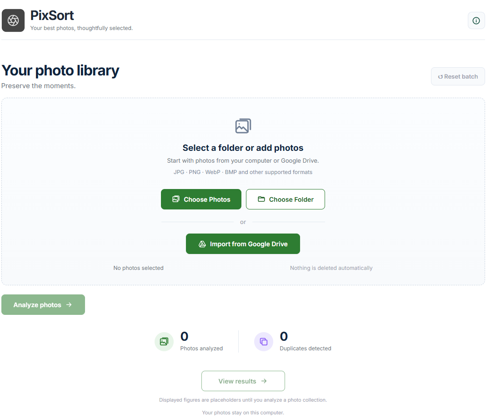
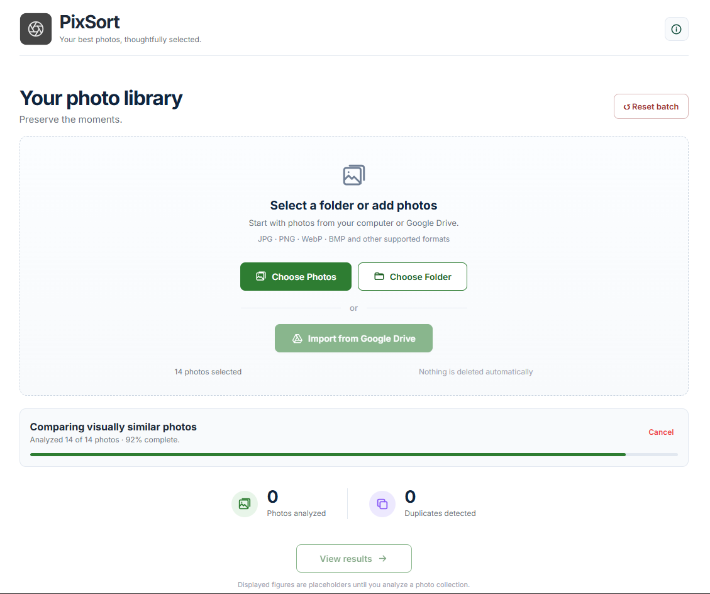
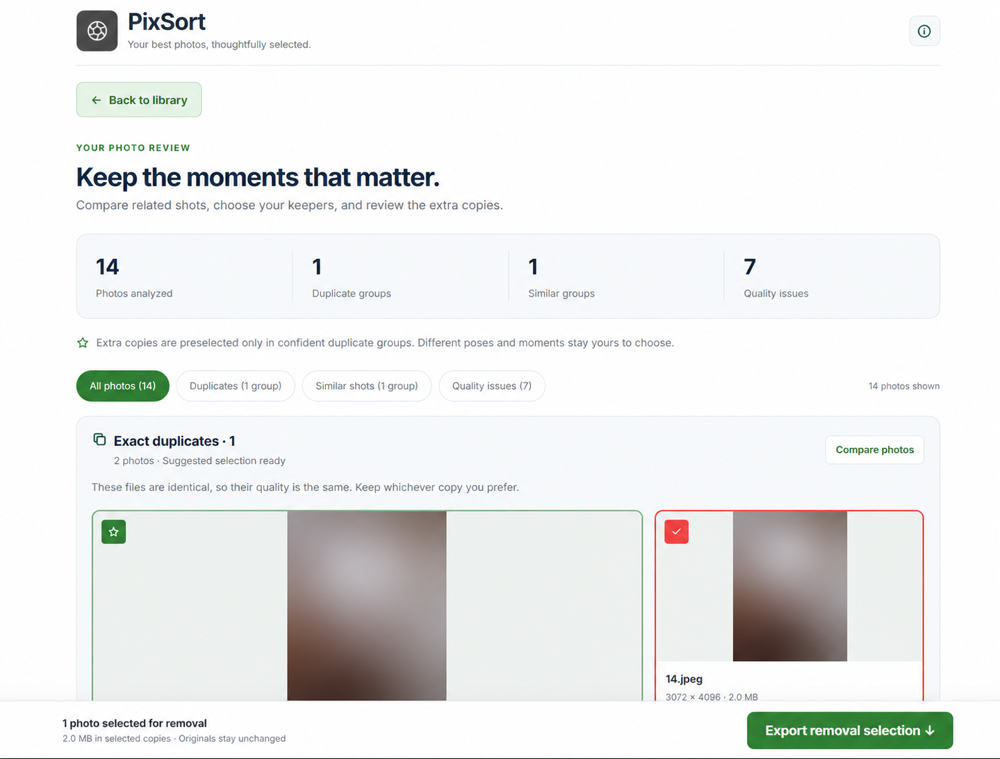

# PixSort

**Your best photos, thoughtfully selected.**

PixSort helps you work through a photo collection without losing track of the moments worth keeping. Add photos from your computer or import a Google Drive file or folder, then review duplicates, related shots, and image-quality warnings in one place.

Analysis runs on your local Python server. You choose what to keep, and PixSort exports your removal selection for reference. It never deletes or changes your original photos.

## A look at the app

### Your photo library

Choose individual photos, select a folder, or start a Google Drive import. **Reset batch** clears the current selection and results when you want to start again.



### Analysis in progress

Follow the current analysis stage and progress, with the option to cancel a running job.



### Review and choose your keepers

Browse grouped photos, compare two shots with preview zoom, and change the recommended keeper. Separate filters help you focus on duplicates, similar shots, or quality issues.



*The photo previews in this screenshot are blurred for privacy. Screenshot counts are examples from a sample batch.*

## What PixSort does

- **Finds exact duplicates** using SHA-256 file hashes.
- **Identifies near-duplicate candidates** using perceptual hashes and checks visual relationships with geometric verification.
- **Groups related shots for review**, including possible bursts and visually similar photos.
- **Flags quality issues** such as possible blur, underexposure, overexposure, and low resolution.
- **Suggests keepers** and preselects redundant copies in confident duplicate groups.
- **Supports local uploads and Google Drive imports** with read-only Drive access.
- **Exports your choices** as a JSON removal-selection manifest. The CLI also produces JSON and HTML analysis reports.

Similar photos can capture different poses, expressions, or moments. Those groups require your judgment; visual similarity alone is not a reason to discard a photo. Byte-identical copies have the same image quality, so either copy can be the keeper.

## Run locally

### Requirements

- Python **3.11 or newer**
- Node.js **20.19+ or 22+**, with npm
- Two terminals: one for the backend and one for the frontend

The commands below use PowerShell and assume you are in the project root.

### 1. Start the backend

```powershell
python -m venv .venv
.\.venv\Scripts\Activate.ps1
python -m pip install -e "./backend[web]"
python -m uvicorn pixsort.main:app --host 127.0.0.1 --port 8000 --reload
```

The backend runs at `http://127.0.0.1:8000`. Interactive API documentation is available at `http://127.0.0.1:8000/docs`.

On macOS or Linux, activate the environment with `source .venv/bin/activate`; the remaining commands are the same.

### 2. Start the frontend

In a second terminal:

```powershell
cd frontend
npm ci
npm run dev
```

Open **http://localhost:5173**. Vite forwards `/api` requests to the local backend on port 8000.

### 3. Review a batch

1. Choose photos or a folder, or import a specific Google Drive link.
2. Start analysis and wait for the review screen.
3. Open a group to compare photos and choose a keeper.
4. Review the preselected copies and any quality warnings.
5. Click **Export removal selection** to download your choices as JSON.

Use **Back to library** to return without losing your review choices. From the library, **Reset batch** clears the batch so you can start again.

## Google Drive setup

Google Drive is optional. Local photo analysis works without Google credentials.

1. Create a project in [Google Cloud Console](https://console.cloud.google.com/) and enable the Google Drive API.
2. Configure the OAuth consent screen and create an OAuth client for a web application. If the app is in testing mode, add the Google accounts that will test it.
3. Register this redirect URI exactly: `http://localhost:8000/api/auth/google/callback`.
4. Copy `backend/.env.example` to `backend/.env` and set:

```dotenv
GOOGLE_CLIENT_ID=your-client-id
GOOGLE_CLIENT_SECRET=your-client-secret
GOOGLE_REDIRECT_URI=http://localhost:8000/api/auth/google/callback
```

An optional `GOOGLE_API_KEY` can be used for publicly accessible Drive resources. Private files and folders require authorization with an account that has access.

Restart the backend after changing configuration. Open the frontend at `http://localhost:5173` when using the callback above so the frontend and callback use the same hostname. Paste a specific file or folder link into **Import from Google Drive** and connect your account when prompted.

PixSort requests the `drive.readonly` scope. Downloads are analyzed locally and temporary image files are removed after the job finishes. Keep credentials in your local environment and out of source control.

## How analysis works

```text
Local photos / Google Drive link
              |
              v
    Temporary local image files
              |
              v
  Metadata, hashes, and quality checks
              |
              v
 Exact duplicates and visual grouping
              |
              v
   Keeper recommendations and review
              |
              v
    Export removal-selection JSON
```

The frontend uses **React, TypeScript, and Vite**. The backend uses **FastAPI**, with **Pillow, OpenCV, NumPy, and ImageHash** for image processing and comparison.

## Limits and behavior

| Item | Current behavior |
| --- | --- |
| Supported formats | JPG, JPEG, PNG, WebP, BMP |
| Batch limit | Up to 200 images |
| File size limit | 25 MiB per image |
| Comparison previews | Up to 1280 × 1280 pixels; reduced-resolution previews |
| Removal export | JSON manifest; no automatic file deletion |
| Review choices | Kept while navigating within the app; cleared on reload, reset, or a new analysis |
| Quality warnings | Suggestions to review, rather than a final judgment of the photo |

The app is designed to run locally. Results and previews are held in server memory while the process runs; temporary image files are cleaned up after analysis. Keep the backend bound to localhost for local use.

## Command-line reports

With the virtual environment activated and the backend installed:

```powershell
python -m pixsort --input "./photos" --output "./output" --recursive
```

This writes `pixsort-report.json` and `pixsort-report.html` to the output directory. Use `--html-output` to choose a different HTML report path. The input photos are left intact.

## Development checks

Backend:

```powershell
python -m pip install pytest
cd backend
python -m pytest -q
```

Frontend, from a separate terminal:

```powershell
cd frontend
npm test
npm run build
```

The production frontend build is written to `frontend/dist/`.

## Project layout

```text
PixSort/
├── backend/
│   ├── src/pixsort/       # API, analysis engine, Drive integration, CLI
│   ├── tests/             # Backend regression and analysis tests
│   └── pyproject.toml
├── frontend/
│   ├── src/               # React screens, components, and services
│   ├── tests/             # Frontend regression checks
│   └── package.json
├── docs/screenshots/      # README screenshots
└── README.md
```

## Contributing

Bug reports and focused improvements are welcome. When reporting an issue, include what you expected, what happened, and the steps needed to reproduce it. Use non-sensitive sample images where possible. For code changes, run the relevant checks and describe any change to grouping or keeper-selection behavior.
